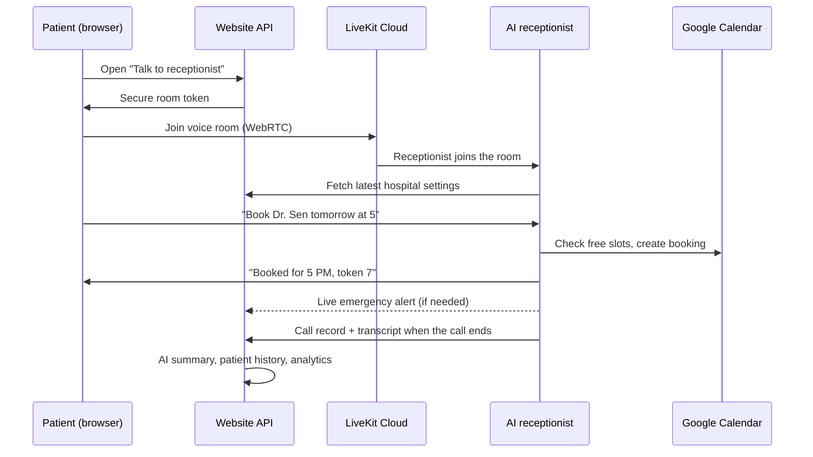
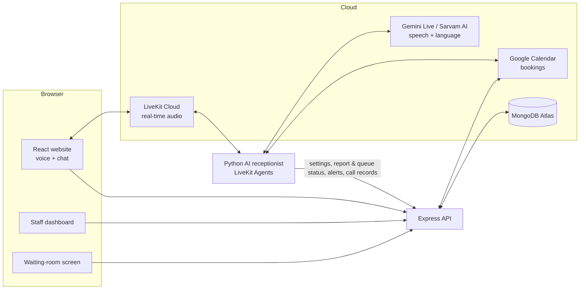

# CityCare — Multilingual AI Voice Receptionist for Hospitals

CityCare is an AI receptionist that **talks to patients in English, Hindi and Bengali**, the way a front-desk
person would. It books, cancels and reschedules appointments, gives each patient an OPD token, books lab tests,
answers questions about the hospital, and **alerts staff the moment a caller describes an emergency**.

A full-stack **MERN website** sits alongside it. Patients talk to the receptionist from the browser. Staff
manage appointments, read call transcripts, run the OPD queue and update hospital information. Every change
made on the website is used by the receptionist from the next call, with no code changes or restarts.

---

## Table of contents

- [Why this project](#why-this-project)
- [What it can do](#what-it-can-do)
- [How a call works](#how-a-call-works)
- [Architecture](#architecture)
- [Tech stack](#tech-stack)
- [Repository structure](#repository-structure)
- [Getting started](#getting-started)
- [Try these conversations](#try-these-conversations)
- [Security and privacy](#security-and-privacy)
- [Testing](#testing)
- [Roadmap](#roadmap)

---

## Why this project

Front desks at Indian clinics and hospitals handle hundreds of calls a day. Many of them repeat: *"Is the
doctor available tomorrow?"*, *"What are the visiting hours?"*, *"Is my report ready?"*. Patients often prefer
their own language, and calls go unanswered at peak hours or after closing time.

CityCare answers every call instantly, in the caller's language, around the clock. It handles the routine work
and sends anything urgent to a human straight away.

---

## What it can do

### For patients (voice or typed chat)

| Feature | Example |
|---|---|
| **Book appointments** with the right doctor, with live availability from Google Calendar | "I want to see Dr. Sen tomorrow evening" |
| **Cancel or reschedule** using the phone number the booking was made with | "Move my appointment to Friday" |
| **OPD tokens**, given at booking and kept when the booking moves | "Your token number is 7, room 12" |
| **Department suggestion** from symptoms, never a diagnosis | "My knee hurts" → Orthopaedics |
| **Covering doctor** offered when a doctor is on leave | "Dr. Sen is on leave today; Dr. Roy can see you" |
| **Lab tests and health packages**: price, preparation and booking | "Book a lipid profile" → "Please fast for 12 hours" |
| **Report status**: only ever ready or not ready, never results | "Is my report ready?" |
| **Live OPD queue** | "Which token is Dr. Bose seeing now?" |
| **Hospital information**: beds (approximate), visiting hours, admissions, insurance and cashless | "Do you accept Star Health?" |
| **Emergency handling**: gives 112 and the hospital emergency and ambulance numbers, and alerts staff | "My father has chest pain" |
| **Indian date phrases** in all three languages | "kal shaam", "কাল বিকেলে", "5টা" |
| **Messages** for staff when the receptionist can't help | "Ask the doctor to call me back" |

### For hospital staff (web dashboard)

| Page | What it does |
|---|---|
| **Dashboard** | Today's calls, appointments, bookings and waiting messages |
| **Appointments** | All bookings with tokens and doctors; cancel or reschedule |
| **Calls & transcripts** | Every call with full transcript, AI summary, outcome and how it ended |
| **Live calls** | Calls happening right now |
| **Patients** | Patient history built automatically from calls and bookings |
| **OPD queue & beds** | "Call next" per doctor; free beds per ward |
| **Waiting-room screen** (`/queue`) | Large "Now serving" token display for a TV |
| **Lab reports** | Add reports and mark them ready or collected |
| **Analytics** | Call volume, outcomes, languages and busiest hours |
| **Settings** | Doctors, hours, leave days, departments, tests, packages, emergency numbers, FAQs |
| **Staff accounts** | Roles: **admin**, **front desk**, **doctor** (own patients only), **lab staff** |
| **Emergency alerts** | A red banner with a sound on every admin page, seconds after emergency words are heard |

---

## How a call works



1. The patient opens the website and presses **Talk to our receptionist**. The website gives the browser a
   short-lived, secure token for a private LiveKit voice room.
2. The AI receptionist joins the room and loads the hospital's current settings: doctors, hours, tests and
   emergency numbers.
3. The patient speaks. **Gemini Live** understands the speech and replies in voice in the same language. For
   actions such as booking, it calls tools that read and write Google Calendar or ask the website for report
   and queue status.
4. If emergency words are detected, staff get an **instant alert** on the dashboard while the call is still
   going.
5. When the call ends, the receptionist sends the transcript and outcome to the website. The website stores
   them in MongoDB and writes an AI summary.

---

## Architecture



**Design choices**

- **Speech-to-speech with Gemini Live** keeps replies fast, because a single model listens and speaks. A
  slower pipeline mode (Sarvam speech-to-text → Gemini → Sarvam text-to-speech) is also supported, for
  Sarvam's Indian voices.
- **Google Calendar is the source of truth for bookings**, so staff can see and edit appointments in a
  familiar app, and doctors can sync it to their phones.
- **The website owns the settings.** The receptionist fetches them at the start of each call, so
  non-technical staff can change doctors, prices or leave days without touching code.
- **The receptionist and the website talk through webhooks** protected by a shared secret. The voice agent
  can run on any machine.

---

## Tech stack

| Layer | Technology |
|---|---|
| Voice agent | Python, LiveKit Agents |
| Speech and language | Google Gemini Live, Gemini Flash; Sarvam AI (Saaras speech-to-text, Bulbul text-to-speech) |
| Real-time audio | LiveKit Cloud (WebRTC) |
| Bookings | Google Calendar API (OAuth) |
| Frontend | React 18, Vite, React Router, LiveKit client SDK |
| Backend | Node.js, Express, JWT authentication, bcrypt, rate limiting |
| Database | MongoDB Atlas, Mongoose |
| Testing | pytest (700+ tests), Node test runner |

---

## Repository structure

```
CityCare/
├── receptionist/                 Python AI voice receptionist
│   ├── receptionist/
│   │   ├── agent.py              Call handling, tools (book, cancel, reports, queue, emergency)
│   │   ├── prompts.py            How the receptionist is instructed to behave
│   │   ├── config.py             Clinic, doctor and hospital settings models
│   │   ├── booking/              Availability, OPD tokens, Google Calendar
│   │   └── integrations/         Website settings, live alerts, emergency detection
│   ├── config/businesses/        Example clinic configurations
│   └── tests/                    Automated tests
│
├── web/                          MERN website
│   ├── client/                   React app: public site, talk page, staff dashboard
│   │   └── src/pages/            Home, Talk, Dashboard, Appointments, OPD, Reports, Settings…
│   └── server/                   Express API
│       ├── src/routes/           Public, auth, admin, hospital, webhooks
│       ├── src/models/           MongoDB models
│       └── test/                 API tests
│
└── README.md
```

---

## Getting started

### What you need

- **Python 3.11+** and **Node.js 20+**
- Free accounts and keys:
  - [LiveKit Cloud](https://cloud.livekit.io): URL, API key and secret
  - [Google AI Studio](https://aistudio.google.com): Gemini API key
  - [Sarvam AI](https://www.sarvam.ai): API key, only for the Sarvam voices
  - [MongoDB Atlas](https://www.mongodb.com/atlas): a free M0 cluster
  - Google Cloud: an OAuth client with the Calendar API enabled

### 1. Receptionist

```bash
cd receptionist
python -m venv .venv
.venv\Scripts\activate          # Windows  (macOS/Linux: source .venv/bin/activate)
pip install -e .
copy .env.example .env          # then fill in the keys below
```

| `.env` key | What it is |
|---|---|
| `LIVEKIT_URL`, `LIVEKIT_API_KEY`, `LIVEKIT_API_SECRET` | From your LiveKit project |
| `GOOGLE_API_KEY` | Gemini key |
| `SARVAM_API_KEY` | Sarvam key (optional) |
| `RECEPTIONIST_AGENT_NAME` | Leave empty so the agent joins website calls |
| `DASHBOARD_WEBHOOK_URL` | `http://localhost:4000/api/webhooks/agent` |
| `DASHBOARD_WEBHOOK_SECRET` | Any long text, the same as in the website |

Create your clinic file from an example in `config/businesses/`. Set `voice.engine` to `gemini_live` and
`languages.allowed` to `["en", "hi", "bn"]`. Then connect Google Calendar and start the agent:

```bash
python -m receptionist.agent dev
```

### 2. Website

```bash
cd web
npm run install:all
copy server\.env.example server\.env   # fill in MongoDB, JWT secret, admin login, LiveKit, webhook secret
npm run dev
```

Open **http://localhost:5173** to use the site and **http://localhost:5173/admin/login** for the staff
dashboard. In **Settings**, click **Fill sample hospital data** to load departments, tests and packages for a
demo.

---

## Try these conversations

| Say | The receptionist… |
|---|---|
| "My knee hurts, which doctor should I see?" | Suggests Orthopaedics and the right doctor |
| "Book Dr. Sen for tomorrow evening" | Checks the calendar, books it and gives a token |
| "আমার অ্যাপয়েন্টমেন্ট শুক্রবারে সরিয়ে দিন" (*"Move my appointment to Friday"*) | Reschedules it, in Bengali |
| "Book a lipid profile tomorrow morning" | Says to fast for 12 hours, then books a lab slot |
| "Is my report ready?" | Asks for the phone number, then gives only the status |
| "What are the visiting hours?" | Answers from the hospital settings |
| "My father has chest pain" | Gives emergency numbers and alerts staff instantly |

---

## Security and privacy

- **No secrets in the code.** Every key and password lives in `.env` files, which are never committed.
  `.env.example` files show the format.
- **Staff logins** use bcrypt-hashed passwords and JWT sessions, with role-based access to each page and API.
- **Agent-to-website calls** are protected by a shared secret header. Public endpoints are rate-limited.
- **Report lookups** need the registered phone number and only ever return a status, never medical results.
- **No medical advice.** The receptionist suggests departments but never diagnoses, and it always directs
  emergencies to 112 and the hospital.
- The design follows the spirit of India's **DPDP Act 2023**: minimal data, a clear purpose and access
  limited by role. Using it in a real hospital would also need paid AI tiers whose data isn't used for
  training, plus a formal compliance review.

---

## Testing

```bash
# receptionist
cd receptionist && pytest

# website API
cd web && npm test
```

The tests cover booking rules, OPD tokens, leave and covering doctors, Indian date phrases, emergency
detection, hospital settings, report and queue tools, webhooks, authentication and role permissions.

---

## Roadmap

- [ ] WhatsApp and SMS confirmations and reminders
- [ ] Predicted waiting time per token
- [ ] Patient self-service page (appointment, token and report status)
- [ ] Bookings stored in MongoDB, for hospitals with many doctors
- [ ] Integration with hospital management systems (HIS) and ABHA

---

**Author:** Anwesha Raha · [github.com/anwesharh](https://github.com/anwesharh)
